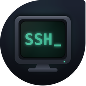
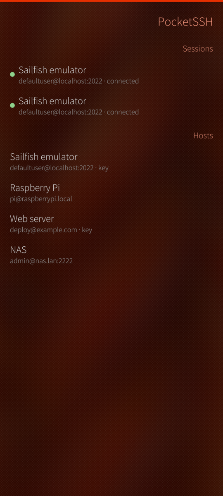
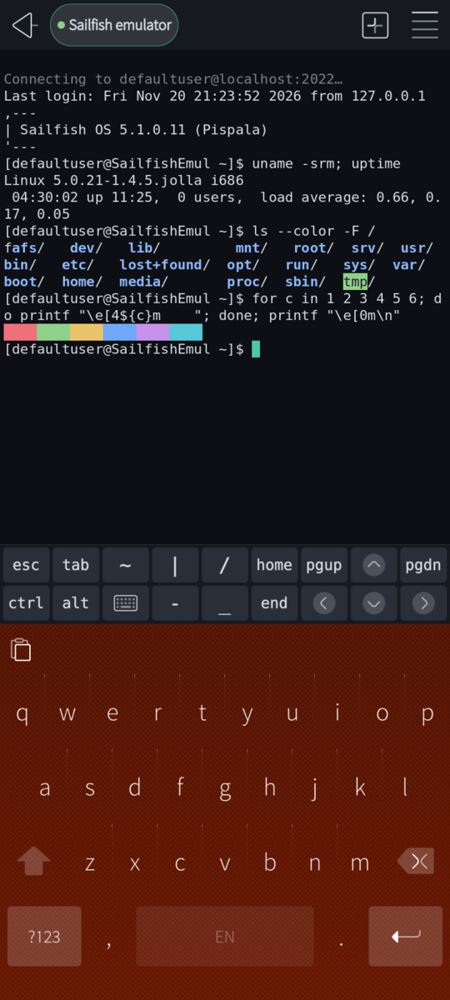
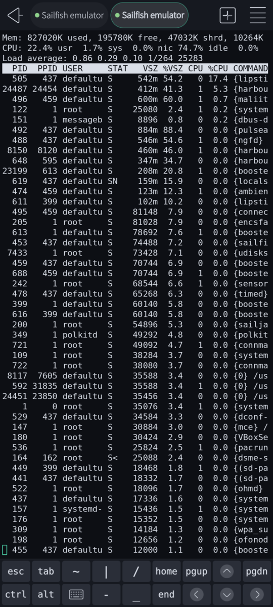
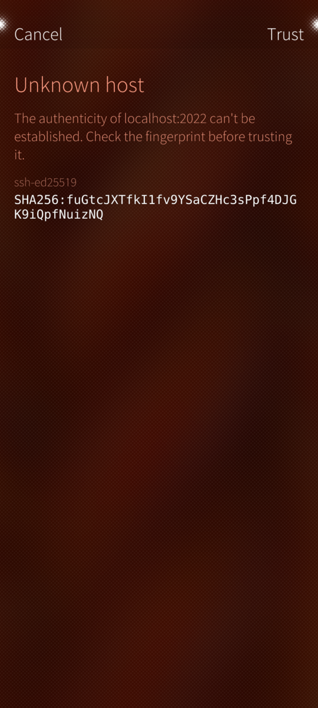
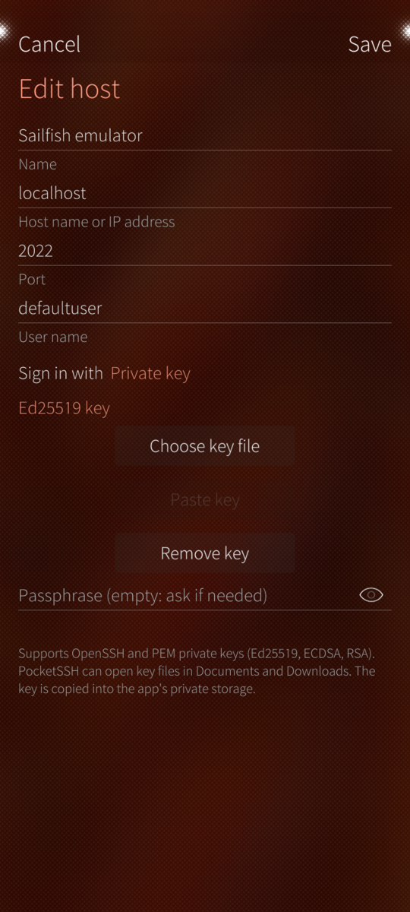
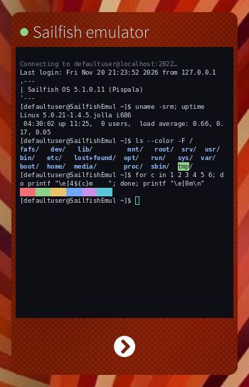

# PocketSSH

An open-source SSH client for Sailfish OS. A port of
[Pocket Shell](https://github.com/HenriVSL/Pocket-Shell) for iPhone and iPad.

<p align="center"></p>

## Screenshots

<p align="center">
  
  
  
</p>
<p align="center">
  
  
  
</p>

## Features

- **Host list:** add, edit, duplicate, reorder and delete hosts; tap a host to connect.
- **Sessions in tabs:** keep several SSH sessions open at once and switch between them from
  the tab strip or the host list. Tab titles follow the terminal title, and a closed session
  reconnects with one tap, keeping its scrollback.
- **Keeps running:** Sailfish OS doesn't suspend background apps, so sessions stay connected
  while you use other apps (keepalives every 30 seconds).
- **Authentication:** password (with keyboard-interactive fallback) or private key (OpenSSH or
  PEM; Ed25519, ECDSA, RSA), with an optional passphrase. If nothing is saved you're asked when
  connecting, and can choose to save it.
- **Host key verification:** on first connect you check and trust the server's SHA-256
  fingerprint; if the key later changes, you get a loud warning. Trusted keys can be reviewed
  and forgotten in Settings.
- **Export and import:** all hosts or a single host as JSON, with or without passwords and keys,
  in the same format as Pocket Shell, so hosts move freely between the two apps.
- **Extra keys:** two rows above the keyboard with esc, ctrl, alt, tab, arrow keys (an inverted
  T, with auto-repeat), home/end, pgup/pgdn, `~ | / - _` and a hide-keyboard key.
- **Terminal:** xterm-256color emulation via libvterm with 256 colors and truecolor, 5000 lines
  of scrollback, flick scrolling, long-press selection and copy, paste, pinch to zoom, tappable
  links, clipboard writes from terminal programs (OSC 52; reads are refused), mouse reporting
  for full-screen programs, and hardware keyboard support.
- **Cover:** a live miniature of the current terminal, with a cover action to switch sessions.

## Install

Download the RPM for your device from
[the latest release](https://github.com/HenriVSL/Sailfish-PocketSSH/releases/latest):

| RPM | For |
|---|---|
| `harbour-pocketssh-<version>-1.aarch64.rpm` | 64-bit ARM phones: Jolla C2, Xperia 10 II and newer |
| `harbour-pocketssh-<version>-1.armv7hl.rpm` | 32-bit ARM devices and 32-bit Sailfish OS installs |
| `harbour-pocketssh-<version>-1.i486.rpm` | The Sailfish SDK emulator |

Not sure? Run `uname -m` in the Terminal: `aarch64`, `armv7l` (armv7hl) or `i686` (i486).
Requires Sailfish OS 5.1 or later.

Then either allow **Settings ▸ Untrusted software** and open the downloaded RPM, or, in
developer mode, run:

```sh
devel-su pkcon install-local ~/Downloads/harbour-pocketssh-*.aarch64.rpm
```

See [docs/RELEASING.md](docs/RELEASING.md#installing-a-release-rpm) for details.

## Build from source

You need the [Sailfish SDK](https://docs.sailfishos.org/Tools/Sailfish_SDK/) with the
5.1.0.11 build targets, or just docker.

```sh
git clone https://github.com/HenriVSL/Sailfish-PocketSSH.git
cd Sailfish-PocketSSH
mkdir build-aarch64 && cd build-aarch64
sfdk -c target=SailfishOS-5.1.0.11-aarch64 build ..    # RPM in RPMS/
```

Without the SDK, `.github/scripts/build-rpm.sh aarch64` builds the same RPM in the
Sailfish OS Platform SDK docker image, exactly as CI does. See
[docs/BUILDING.md](docs/BUILDING.md) for details, installing on a device and CI.

## Documentation

| Document | Contents |
|---|---|
| [docs/ARCHITECTURE.md](docs/ARCHITECTURE.md) | How the app is put together: layers, threading, session flow, file map |
| [docs/CONFIG_FORMAT.md](docs/CONFIG_FORMAT.md) | The export/import JSON format (shared with Pocket Shell) |
| [docs/SECURITY.md](docs/SECURITY.md) | Security model, what is stored where, and how to report vulnerabilities |
| [docs/BUILDING.md](docs/BUILDING.md) | Requirements, building with the SDK or docker, installing on a device, CI |
| [docs/RELEASING.md](docs/RELEASING.md) | Making a release, and installing a release RPM |
| [CONTRIBUTING.md](CONTRIBUTING.md) | How to contribute |
| [THIRD_PARTY_NOTICES.md](THIRD_PARTY_NOTICES.md) | Licenses of bundled libraries |

## License

MIT, see [LICENSE](LICENSE).

PocketSSH bundles libssh2 (BSD-3-Clause) and libvterm (MIT), and uses the system's
OpenSSL 3 (Apache-2.0). See [THIRD_PARTY_NOTICES.md](THIRD_PARTY_NOTICES.md).
